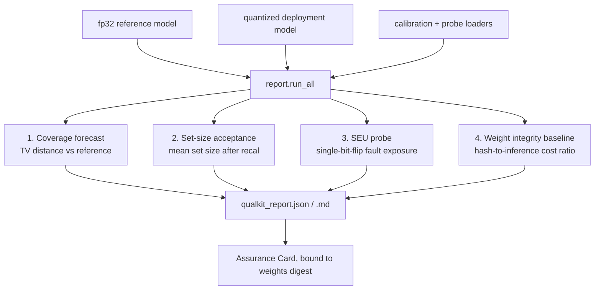

# qualkit

Pre-flight assurance checks for compressed classification models. If you are
about to deploy a quantized model whose predictions carry a conformal
guarantee, qualkit tells you, before deployment, what compression did to that
guarantee and what your fault exposure is.

Four checks, each implementing a measured finding from a 12-finding research
programme (github.com/ss1738/euroSAT-CNN-landcover, all reproducible):



1. **Coverage forecast.** Coverage loss under stale calibration is bounded by
   (and on peaked tasks approximately equals) the TV distance between your
   reference and deployment score distributions, computed on the labeled
   calibration set you already have. Validated across 2 datasets, 2
   architectures, 5 bit-widths, 60/60 runs.
2. **Set-size acceptance.** Recalibration always restores validity, but below
   a precision knee the prediction sets balloon toward all classes: valid but
   uninformative. Mean set size on calibration data is the acceptance test.
3. **SEU probe.** 83 to 100% of single stored-weight bit flips are
   output-silent, so no output-side monitor can count faults. Integer
   storage bounds per-flip damage; FP32 does not (one exponent flip can halve
   accuracy). The probe measures both on your model.
4. **Weight integrity baseline.** The fix for silent faults is weight-side
   hashing; qualkit reports the digest and the measured hash-to-inference
   cost ratio so you can pick your hash-every-N-frames overhead.

## Use

```python
from qualkit import report
r = report.run_all(model_fp32, model_quantized, cal_loader, probe_loader,
                   alpha=0.10, seu_bits=8)
report.save(r)   # qualkit_report.json + qualkit_report.md
```

Demo (trains a quick EuroSAT model, quantizes to 4 bits, prints the report):

```
python3 examples/eurosat_demo.py
```

## Scope and honesty

- Classification with split conformal prediction; single-label; PyTorch.
- The coverage forecast errs safe: it never underestimates the loss, and is
  near-exact on concentrated score distributions.
- The SEU probe injects software bit flips into weights only; it is not a
  radiation test.

## Assurance Cards

qualkit reports can be emitted as **Assurance Cards** (spec `ASSURANCE_CARDS.md`):
model cards that carry measured guarantees, bound to a weights digest, with the
validity assumptions stated. Generated, never hand-written.

MIT licence. Research behind every check: github.com/ss1738/euroSAT-CNN-landcover
